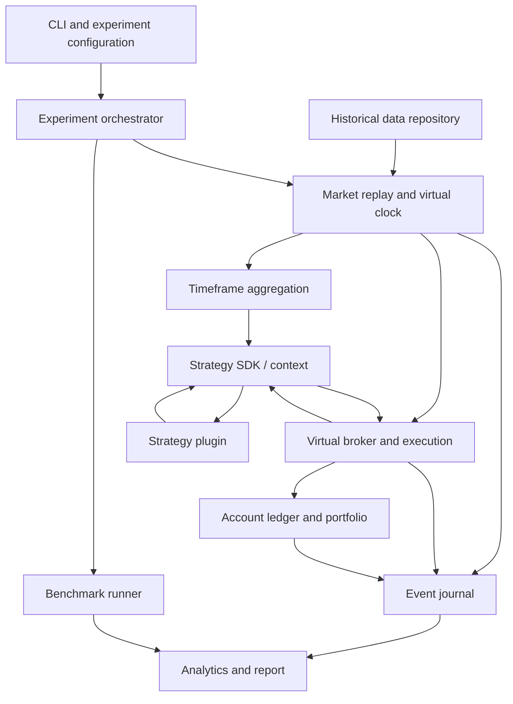

# Historical Market Simulation & Backtesting Platform
## Product requirements and implementation specification

**Version:** 0.1 (proposed) | **Status:** Draft for review | **Working title:** Backtesting Platform

This is a normative specification for an implementation LLM and a human maintainer. MUST denotes a release requirement, SHOULD a recommended default, MAY an optional capability. Proposed decisions are explicitly identified; do not silently expand scope or invent missing execution rules.

## 1. Purpose and scope

Build a strategy-independent, accelerated historical market and virtual brokerage environment. A trading bot submits orders and receives market and execution events as if connected to a broker, without seeing future observations. Months or years of historical activity should be replayable in minutes or hours where computationally feasible. The platform is initially for conventional rule-based bots (ICT/SMC, trend following, mean reversion, breakout, indicator systems, intraday and swing strategies), not a neural-network prediction system. ORACLE and other ML systems may later use the same interface.

The platform owns data, simulated time, order execution, account accounting, benchmarking and reporting. Strategies own signal generation, trade decisions and optional sizing. Do not hardcode a specific strategy, train neural networks, connect to a real-money broker, or promise future profitability in v1. Historical simulation complements, not replaces, forward testing.

Universal support means any strategy compatible with the protocol and available point-in-time data; it does not mean arbitrary existing bots run unchanged. Strategies requiring order book depth, fundamental/news data, options pricing, market impact, or external systems need suitable data and extensions.

## 2. Release boundaries and proposed decisions

| Item | Proposed v1 decision | Later extension |
|---|---|---|
| Language | Python 3.12+ (pin supported version) | Native acceleration where profiled |
| Interface | In-process Python SDK and local CLI | IPC/network adapters, other languages |
| Instruments | XAUUSD first; generic linear instrument metadata; multiple subscriptions and shared account | Options, futures rolls, full multi-currency conversion |
| Market data | OHLCV and bid/ask quote ticks; optional trade ticks | Depth, fundamentals, news |
| Data storage | Parquet + metadata manifest; SQLite for run index | Distributed storage |
| Results | JSON, Parquet/CSV, self-contained HTML report | Interactive dashboard |
| Account model | Configurable linear CFD-like model, explicit hedging/netting mode | Broker-specific plugins |
| Clock | UTC internally; configurable session/timeframe boundaries | Additional calendars |
| Execution | Deterministic configurable quote/bar fill models; no market impact | Depth and queue simulation |
| Benchmark | Seeded matched random ensembles and simple baselines | More sophisticated null models |
| Safety | Trusted local strategy code; no real orders | Sandboxed third-party strategy runners |

These are recommendations, not user-confirmed technology choices. Keep core domain types independent of storage and transport. Support both continuous and random-window runs in v1. Do not build a GUI until the CLI engine passes correctness tests.

## 3. Architecture and ownership



- Repository: import, normalize, validate, version and query source data. Only engine code receives unrestricted historical access.
- Replay: merge chronologically ordered streams, advance the virtual clock, handle scheduled events and terminate runs.
- Aggregator: maintain completed and optional partial candles per instrument/timeframe, with no future data.
- Strategy host: load plugins, manage lifecycle, deliver subscribed events and expose read-only snapshots and commands.
- Broker: validate orders, model fills, maintain order/position state and risk checks.
- Ledger: record cash, realized/unrealized P&L, fees, equity and margin with auditable transactions.
- Experiment runner: isolate runs, build repeatable windows/seeds, schedule parallel independent jobs, collect failures.
- Analytics: derive metrics from ledger and event logs; no mutation of execution state.

## 4. Functional requirements

| ID | Requirement |
|---|---|
| DATA-01 | Import local historical data, validate schema, provide dataset manifest and quality report. |
| DATA-02 | Support configurable instrument metadata, tick quotes, OHLCV, timestamp conventions and session calendars. |
| TIME-01 | Advance simulated time monotonically; never sleep to simulate historical elapsed time in maximum-speed mode. |
| TIME-02 | Support multiple concurrent timeframes, closed and optional partial bars, scheduled callbacks. |
| STR-01 | Load a user strategy with a documented SDK contract, configurable parameters and independent state per run. |
| STR-02 | Allow market queries, account/order queries and explicit order commands, with no unrestricted data access via SDK. |
| EXE-01 | Implement market, limit, stop and stop-limit orders; cancel, modify, close, partial close; protective SL/TP. |
| EXE-02 | Apply spread, slippage, fees, financing, volume constraints, margin and deterministic fill policy. |
| ACC-01 | Maintain balance, equity, exposure, P&L and margin, including liquidation policy. |
| EXP-01 | Continuous replay and seeded historical-window sampling; independent account per run. |
| EXP-02 | Preserve configuration, seeds, dataset fingerprints and strategy version; record failed runs. |
| BEN-01 | Compare strategy to a distribution of random runs with comparable risk and execution assumptions. |
| REP-01 | Produce trade counts, win rate, net P&L, return, frequency, holding duration, drawdown and benchmark comparison. |
| REP-02 | Export orders, fills, trades, equity, benchmark distributions and run warnings. |
| QA-01 | Verify causality, accounting, event ordering and execution behavior with synthetic fixtures before historical research. |

## 5. Historical data contract

### 5.1 Schemas

All timestamps are timezone-aware UTC, stored as integer nanoseconds or a consistent Arrow UTC timestamp. Source timestamps and source timezone must be preserved in metadata. Monetary and order quantities use exact decimal or scaled integers in ledger and broker; floating-point permitted in statistical analytics with documented tolerances.

| Record | Required fields | Optional fields |
|---|---|---|
| QuoteTick | instrument_id, timestamp, sequence, bid, ask | bid_size, ask_size, source |
| TradeTick | instrument_id, timestamp, sequence, price, quantity | side, source |
| Bar | instrument_id, timeframe, open_time, close_time, open, high, low, close, price_basis | volume, tick_count, source |
| Instrument | id, currency, contract_size, price_tick, quantity_step, min_qty, max_qty, margin model, calendar | max_leverage, commission model, financing rules |
| Manifest | dataset_id, version, content hash, provider, coverage, granularity, price_basis, timezone, schema_version | known gaps, license, import settings |

Bars use half-open intervals [open_time, close_time). A completed bar becomes visible at close_time, never open_time. Distinguish real traded volume from tick volume and unavailable volume. Never assume XAUUSD contract size or leverage universally; configure according to the broker instrument specification. For initial implementation, account currency equals instrument quote currency; reject incompatible instruments unless a point-in-time FX conversion adapter is configured.

### 5.2 Import and quality checks

Support CSV and Parquet adapters with explicit column mapping; no guessed date format or price basis. Validate monotonic timestamps after stable sorting, finite positive prices for supported instruments, OHLC consistency, bid <= ask, valid quantity, duplicate keys, interval consistency and calendar alignment. Duplicate conflicting observations fail import by default; exact duplicates may be deduplicated with recorded counts. Report gaps relative to trading sessions, missing periods, outliers and coverage per instrument. Never silently forward-fill prices for execution. If a gap crosses a held position, apply documented gap-fill rules and flag the interval; configurable strict mode aborts on material gaps. Weekend and holiday closures are not necessarily missing data. Source data must not be silently modified; cleaning creates a new version.

Partition Parquet by instrument and date/month as appropriate; stream batches rather than loading all tick history. Cache immutable derived datasets with source hash, calendar, price basis and aggregation settings in the key.

## 6. Virtual clock and timeframe semantics

Support tick, 1m, 2m, 3m, 5m, 10m, 15m, 30m, 1h, 2h, 4h, 6h, 8h, 12h, 1d, 1w and calendar month; permit custom positive fixed-duration periods. Daily/weekly/monthly boundaries must use configured exchange/broker calendar and timezone, not blindly fixed UTC durations. DST, shortened sessions and market closure policy must be explicit. Fixed intraday periods may use UTC or configured session anchors. Reject unsupported requests for resolution finer than source data; never synthesize tick precision from OHLC.

Aggregate from the finest suitable input: open first observed price, high maximum, low minimum, close last observed price, volume sum if meaningful. Quote bars use an explicitly configured bid/ask/mid basis. Do not invent empty candles unless an opt-in analytics-only policy marks them synthetic and excludes them from fills. Historical bars can be resampled only when boundaries align and all necessary source intervals are available.

At simulated 09:47 a 09:45–10:00 M15 bar is not complete. If source is ticks or M1 bars, a partial M15 bar may include only observations already available. A strategy requesting closed M15 candles must receive bars ending no later than current virtual time. Same rule for higher timeframes; no precomputed future high/low or centered indicators. Warmup must include enough preceding history for the longest requested lookback across all subscriptions (e.g., 300 D1 bars is not 300 M15 bars). Fail or explicitly flag insufficient warmup; do not shorten silently. Warmup callbacks may initialize indicators but cannot place live simulation orders by default.

### 6.1 Event ordering

Replay by (timestamp, phase, instrument stable key, source sequence). Define timestamp phases as part of a versioned execution contract:
1. Process calendar transitions and due expirations/financing according to configured schedule.
2. Ingest observations available at that timestamp; update market snapshots and process previously eligible orders on the relevant instrument. Tick observations at identical timestamps retain source sequence; cross-instrument ties use deterministic ordering, not presumed real-world simultaneity.
3. Finalize bars whose closing boundary is reached using only observations belonging to their half-open intervals. A quote at exactly the boundary belongs to the new bar. If a source bar itself ends at the boundary, its OHLC is used only now.
4. Deliver resulting order/fill/position notifications and market events; market callbacks see a coherent snapshot at the defined event boundary. Order updates generated during callbacks are queued, not reentrant.
5. Apply strategy commands in submission order, validate, acknowledge and schedule eligibility. Default orders cannot fill against a market observation already consumed before submission; next eligible observation is required. A configurable immediate quote model may use current bid/ask for market orders if explicitly labeled and tested.
6. Record account mark and scheduled callbacks according to documented phase ordering. Commands from scheduled callbacks follow the same eligibility rule. Flush notifications without advancing time and enforce a bounded callback/event loop.

For bar-only execution, existing orders are evaluated on the next source bar as a unit, before the strategy receives its completed contents. Fills at the modeled bar open are recorded with modeled event time and known-at close_time; do not let callbacks react inside a bar whose path is unknown. No same-bar fill from a close-derived signal. If a scheduled callback occurs mid-bar, no undisclosed OHLC information may be exposed. Explicitly document uncertainty and distinguish modeled fill time from observation availability.

Simulation begins with initial account at trade_start, ends at end_time exclusive for new observations/orders; define final mark using last available eligible quote. Default cancel pending orders and report open positions marked to market; optional force close at last known executable quote with an explicit synthetic termination flag. Never use a future observation to liquidate.

## 7. Strategy SDK and integration contract

Python is the proposed first SDK. Strategies implement a factory and lifecycle; no engine dependencies beyond public domain types. Example (illustrative API, implementation not supplied):

```python
class Strategy:
    def on_start(self, ctx): ...
    def on_warmup(self, event, ctx): ...
    def on_market(self, event, ctx): ...
    def on_order_update(self, event, ctx): ...
    def on_fill(self, event, ctx): ...
    def on_timer(self, event, ctx): ...
    def on_finish(self, ctx): ...
```

Manifest: strategy_id, version, entrypoint, parameters with type/default/range, instrument subscriptions, requested timeframes, lookbacks, tick subscription flag, optional scheduled events, required data types. Validate before run. One fresh instance per run; no shared mutable module globals. Provide seeded per-strategy RNG; use virtual `ctx.now`, not wall time or sleep. External API and arbitrary filesystem access are unsupported in reproducible mode; in-process Python is not a security sandbox. Strict isolation for untrusted code is a future separate-process restricted-filesystem/network implementation.

Public context methods (proposed names):

| Method | Contract |
|---|---|
| now | Current simulated UTC time |
| bars(symbol, timeframe, count, include_partial=False) | Immutable chronologically ordered history bounded by clock; partial explicitly flagged |
| quote(symbol) | Latest available bid/ask with timestamp and stale flag; unavailable if no quote |
| ticks(symbol, count) | Recent available ticks only; bounded history |
| account() | Immutable account snapshot |
| positions(symbol=None) / orders(symbol=None) | Immutable snapshots of open state |
| submit_order(request) | Returns submission ID; acceptance/fill communicated by events |
| cancel_order(id) / modify_order(id, changes) | Explicit acknowledgement or rejection |
| close_position(id, quantity=None) | Market close command targeting position |
| schedule_at(time, tag) / cancel_timer(id) | Virtual-time event, reject times in past |
| log(level, message, fields) | Structured run log |
| rng | Seeded strategy random stream |

All commands have request_id, strategy_id, simulated submission time and optional client tag. Idempotency: duplicate request_id with identical payload returns prior outcome; conflicting payload rejects. Version domain schemas. No callbacks receive a full dataset, future index, future aggregate, or arbitrary historical query beyond now. A strategy may use indicators, ML inference or custom logic; training data provenance must be controlled externally for later ML use.

Signals are not executions. BUY/SELL without an order type and quantity or configured sizing policy is not a complete execution request. WAIT is no command. Strategy may emit diagnostic signals separately for reporting.

Example order request:

```json
{"request_id":"r-001","instrument":"XAUUSD","side":"BUY","type":"LIMIT","quantity_lots":"0.05","limit_price":"2650.00","stop_loss":"2645.00","take_profit":"2665.00","time_in_force":"GTC","client_tag":"liquidity-sweep"}
```

Market orders forbid limit/stop trigger fields; LIMIT requires limit_price; STOP requires stop_price; STOP_LIMIT requires both. SL/TP are absolute prices by default; optional relative distances must be a distinct field. Quantity may be omitted only if a configured sizing policy resolves it. SDK and broker must not both size the same order. Reject unsupported commands rather than silently converting them.

## 8. Virtual brokerage and order model

### 8.1 Order state and types

Order states: SUBMITTED -> ACCEPTED or REJECTED; ACCEPTED -> ACTIVE, CANCELLED, EXPIRED or REJECTED if pre-activation checks fail; ACTIVE -> PARTIALLY_FILLED, FILLED, CANCELLED, EXPIRED; PARTIALLY_FILLED -> FILLED, CANCELLED, EXPIRED. STOP_LIMIT has a triggered substate and becomes a limit order. Terminal states immutable; modifications version the order, retain audit history and do not change filled quantity. v1 quote/bar model defaults to full fills; partial fills supported only with a configured capacity model, never inferred from missing depth. Partial position closes are required independent of partial order fills.

Time in force: GTC and GTD required; DAY using calendar; IOC/FOK only when capacity/execution semantics are implemented, otherwise explicit rejection. Expiry at timestamp is processed before new matching at that timestamp. Cancellation after fill rejects. Modify pending price/quantity/protection subject to validation; modifying a partially filled order cannot reduce total quantity below filled amount. Use explicit position identifiers in hedging mode. In netting mode one net position per instrument; opposite fills reduce, close or reverse; define FIFO matching of entry lots for accounting. No position reversal from a reduce-only protective or close order.

### 8.2 Fill model (quote ticks)

| Order | Trigger / execution |
|---|---|
| Buy market | Eligible ask plus adverse slippage |
| Sell market | Eligible bid minus adverse slippage |
| Buy limit | Ask <= limit; fill at ask or limit according to price improvement policy, never above limit |
| Sell limit | Bid >= limit; fill at bid or limit according to policy, never below limit |
| Buy stop | Ask >= stop; becomes market order, gap/slippage may worsen price |
| Sell stop | Bid <= stop; becomes market order, gap/slippage may worsen price |
| Stop-limit | Trigger as stop; thereafter obey limit price constraint; may never fill |
| Long SL / TP | Exit on bid <= SL / bid >= TP |
| Short SL / TP | Exit on ask >= SL / ask <= TP |

Protective SL is modeled as stop-market; TP as limit-like exit, no fill worse than TP under that model. SL/TP activate only for filled position quantity, update on partial closes and cancel sibling when position fully closes (OCO). Validate relative side at submission or modification against configured reference, enforce minimum stop distance where specified. If entry gaps past protection, apply explicit immediate protective eligibility policy; default evaluate on next eligible quote, flag gap exposure. Trailing stops are optional v1 extension; if enabled update only on observed executable side and never loosen unless an explicit modification is submitted.

Slippage models: none, fixed ticks, seeded stochastic adverse ticks, optional volatility-dependent model using past data. Apply slippage only where price constraints permit. Spread: historical bid/ask preferred; single-price input requires explicit spread model and price basis. For mid price, bid=mid-spread/2 and ask=mid+spread/2, rounded conservatively to price tick. Never add a second spread to already bid/ask data. Quotes may be stale; default reject new market fills until a fresh observation. Liquidity is assumed sufficient unless a documented model says otherwise; reports label this limitation. No claim of actual broker fill fidelity.

### 8.3 OHLC execution fallback

Use next eligible bar open for market orders; evaluate existing stops/limits against side-specific modeled ranges. Gap through stop fills at adverse executable open plus slippage; favorable gap through limit follows configured price improvement. Intrabar limit touch assumes fill only under configured touch policy; optional require penetration by N ticks. If both SL and TP reachable in same bar and order unknown, default stop-first for already-open position, record ambiguity. For entry and exit reachable in same bar, do not assume favorable sequence; use conservative feasible path model or mark unresolved and apply selected strict policy. Implement deterministic path alternatives O-H-L-C and O-L-H-C for sensitivity analysis; they are assumptions, not reconstructed truth. Reports count ambiguous bars/trades. Prefer actual quote ticks for strategies sensitive to intrabar order. No tick strategy against OHLC-only data unless explicitly adapted to bar events.

### 8.4 Costs and constraints

Configurable commission per side/per lot/notional or fixed ticket, minimum commission, account currency rounding, overnight financing/swap with explicit rollover time, day multipliers and long/short rates. Missing historical costs use documented model assumptions; report whether costs are historical or estimated. Validate trading session, price tick, lot step, min/max quantity, order type, available margin, maximum open exposure, optional risk cap and stop distances. Market closed policy reject or queue explicitly; default reject new market orders and allow cancel of pending orders. Recheck margin at fill because prices may change. Do not execute orders on missing or stale quotes. Deterministic rejection codes and detailed reason required.

## 9. Account, ledger and risk

Config: starting balance > 0, currency, default lot size, sizing mode, leverage/margin schedule, position mode, stop-out threshold and liquidation order. Initial proposed model is linear instrument, quote currency = account currency. Units = lots × contract_size. Long gross P&L = (exit bid - entry ask) × units; short gross P&L = (entry bid - exit ask) × units. Spread and modeled slippage already reflected in fills; never deduct again. Net P&L = gross realized P&L - attributable commissions - financing and other explicit costs. Balance = starting cash + realized P&L - posted costs; equity = balance + unrealized P&L marked at executable liquidation side. Used margin = sum of required margin under configured broker rules (simple notional/leverage default; hedged offsets only if specified). Free margin = equity - used margin. Margin level = equity / used margin × 100; undefined when margin zero. Pending-order margin reservation policy explicit; default reserve estimated required margin for accepted pending orders and revalidate at trigger.

Risk sizing optional: fixed lot default or risk fraction × equity / estimated loss per lot at SL including modeled costs, rounded down to lot step; reject missing/invalid stop for risk sizing, reject below min lot rather than round up. Risk estimate not guarantee under gaps. Allow strategy override only according to config. User can input balance and lot size for each experiment. Support partial close, weighted average entry and FIFO lot attribution; fees allocated proportionally with rounding remainder assigned deterministically. Journal every cash movement with unique ID, position/order reference and reason. Equity and balance must reconcile to journal at every event. No negative-balance protection unless configured. Stop-out: on observed margin threshold breach, cancel pending orders, liquidate positions using deterministic worst-unrealized-loss-first (tie by ID), recompute after each fill; flag inability to liquidate without eligible quote. No invented liquidity. Terminate bankrupt run according to configured policy; report actual elapsed window and reason.

## 10. Experiment modes and statistical validity

Continuous mode: one contiguous [trade_start, end) range with preceding warmup. Random-window mode: draw eligible contiguous start times from declared population, with configurable duration (calendar time, trading time or candle count; never conflate), count, seed, sampling with/without replacement and optional non-overlap. Do not shuffle individual candles. Prevalidate warmup and coverage for all subscriptions; record actual sampled windows and rejected candidates. Independent strategy/account state each run; no cross-run learning unless explicitly implementing walk-forward training. Report overlapping windows and do not claim independent samples. Optional stratification by year/session/regime uses point-in-time classification or explicitly retrospective descriptive labels. Keep development/validation/holdout chronological, immutable dataset split manifests; avoid tuning on holdout. Walk-forward later: rolling training/validation/test windows, fit only on earlier data, freeze parameters during test. Purge/embargo overlapping labels when ML is added. Repeated testing on holdout erodes independence; log experiment history including failed strategies and parameter searches.

Reproducibility: master seed generates stable child seeds by hash of run/window/benchmark identity, not process completion order. Store exact strategy source/version hash, config, engine version, dataset manifest/hash, Python/dependency lock, seed, execution model version, calendar version, platform and warnings. Deterministic replay expected for deterministic strategies and identical environment; parallel runs must match serial semantic results (excluding wall-clock runtime and run IDs). Store run artifacts atomically; interrupted runs marked incomplete and excluded from completed aggregates unless explicitly requested.

## 11. Random benchmarks and comparison

Run strategy and benchmarks against identical historical windows, market data, account size, fee/margin constraints and execution model. Do not use a single random trial as evidence. Proposed default 1,000 trials configurable, start with smaller smoke tests. Distinguish benchmarks:

- Random policy: seeded entry probability per eligible decision event, random side, configured position sizing and holding/exit rules. Calibrate entry rate/risk/holding distribution from development data, freeze before evaluation. Same trading session restrictions and exposure caps.
- Direction ablation: randomize direction at strategy signal opportunities; map SL/TP distances relative to randomized entry side; separate signal generator from execution state where needed. If future signals depend on positions, rerun actual strategy logic with altered policy rather than pretend identical independent opportunities.
- Entry ablation: random eligible entry opportunities with comparable exit rules and risk. For strategies with state-dependent exits, define adaptation contract; if unavailable mark not applicable.
- Matched retrospective diagnostic: use observed trade count/holding time/risk distribution from evaluation run to construct conditional random trials, explicitly label as post-hoc diagnostic, not deployable policy or independent hypothesis test. Do not inject realized future holding duration into strategy under test.
- Nonrandom baselines: no trade/cash, simple long-only exposure where appropriate, simple predeclared indicator strategy. No guarantee these are suitable for every instrument.

Primary score proposed: net return over fixed horizon under equivalent capital and risk budget; secondary scores max drawdown, expectancy and risk-adjusted return. Report empirical distribution, median, mean, quantiles 5/25/75/95, benchmark sample size and actual matching deviations. Percentile = fraction of random results below observed plus half of ties. One-sided Monte Carlo tail estimate = (1 + number of random scores >= observed) / (N + 1) for valid exchangeable null simulations; otherwise label empirical exceedance frequency, not a formal p-value. Do not claim significance from a weak null or dependent windows. For multiple windows compare paired strategy/benchmark results and report per-window distribution; aggregate with documented weighting. Do not pool overlapping windows as independent trades. Later add block-bootstrap confidence intervals and multiple-testing adjustment (e.g. Holm for predeclared hypothesis family). No arbitrary pass/fail based on win rate or percentile alone. Record failures and unmatched constraints; never silently reroll unfavorable benchmark outcomes.

## 12. Reporting specification

Every report includes configuration, data coverage, model assumptions, duration, strategy/version, benchmark settings, warning counts, run completion status and full transaction audit. Define a closed trade as a matched entry/exit lot record, and separately report position episodes (flat-to-flat or position-ID lifecycle), order counts and fills so partial closes cannot inflate counts without disclosure. Primary win rate uses closed position episodes net of allocated costs; break-even episodes separate, denominator all closed episodes; also report matched-lot statistics. Open trades excluded from realized win rate, included in marked equity and exposure.

| Metric | Definition |
|---|---|
| Initial/final balance | Posted cash at start/end |
| Final equity | Final balance plus unrealized P&L |
| Net return | (final equity / initial equity - 1) × 100; no external flows v1 |
| Realized net P&L | Realized gains/losses less attributed costs; reconcile unallocated costs |
| Win/loss/breakeven | Closed episode net P&L > / < / = 0 (currency rounding tolerance) |
| Win rate | wins / all closed episodes |
| Profit factor | sum positive net episode P&L / absolute sum negative net episode P&L |
| Expectancy | mean net P&L per closed episode |
| R multiple | net P&L / initial planned monetary risk; undefined without valid SL/risk |
| Max drawdown | maximum (running peak equity - current equity) / running peak equity; include initial equity |
| Drawdown duration | elapsed peak-to-recovery time, censored at end if unrecovered |
| Trade frequency | entries, closed episodes, fills per calendar and trading day/week/month separately |
| Holding period | entry-fill to exit-fill duration; mean, median, min/max, quantiles; partial close weighting documented |
| Intertrade time | elapsed time between entry events, with simultaneous entries retained |
| Time in market | union of intervals with nonzero exposure / elapsed window; per symbol optional |
| Sharpe | mean fixed-interval excess equity return / sample SD × sqrt(periods per year); explicit risk-free rate and annualization |
| Sortino | mean excess return / downside deviation × sqrt(periods per year); define downside target |
| Exposure | time-weighted gross/net notional, max simultaneous positions and margin usage |
| Benchmark | observed score, null distribution, percentile, paired difference, matching diagnostics |

Use fixed-interval equity sampling (proposed daily calendar UTC or configured trading calendar) for annualized statistics; label methodology. Do not annualize irregular trade returns as daily returns. No trades: win rate, expectancy, profit factor undefined; zero losses with positive profits: profit factor infinite (JSON null plus status), zero variance Sharpe undefined. No fabricated zero values for undefined metrics. Report both realized balance and marked equity curves, peak drawdown, P&L histogram, duration histogram, trade frequency over time, session/day/week/month breakdown, instrument and long/short breakdown, random distribution and representative benchmark quantile bands. Session labels use timezone/DST-aware configured definitions and may overlap; state whether buckets overlap. Include trade-level entry/exit timestamps, modeled/actual flag, quantity, prices, costs, stop/TP, reason, MFE/MAE where observable, client tags and ambiguous execution flags. MFE/MAE from observed executable prices only; bar estimates labeled approximate. Include all rejected/cancelled orders and reasons.

Outputs: report.html self-contained (no network dependency), summary.json schema versioned (strict JSON, no NaN), orders.parquet, fills.parquet, trades.parquet, ledger.parquet, equity.parquet, events.parquet or JSONL, benchmarks.parquet, manifest.json, warnings.json. CSV export optional. HTML and JSON must derive from same analytics results. For large tick runs default journal market event counts and orders/fills rather than every tick; full market trace opt-in. Retain source hashes to reconstruct replay.

## 13. Configuration and CLI

Proposed configuration YAML (illustrative values, not verified broker terms):

```yaml
schema_version: 1
strategy:
  entrypoint: strategies.example:build_strategy
  parameters: {fast_period: 20, slow_period: 50}
market:
  dataset: data/xauusd/manifest.json
  instruments: [XAUUSD]
  timeframes: [1m, 15m, 1h, 4h, 1d]
  calendar: config/calendars/example.yaml
  candle_price_basis: mid
account:
  currency: USD
  starting_balance: '10000'
  default_lots: '0.05'
  sizing_mode: fixed_lots
  position_mode: hedging
  leverage: '30'
  stop_out_percent: '50'
execution:
  model: quote_tick
  eligibility: next_observation
  spread_model: historical
  slippage_model: {type: fixed_ticks, ticks: 0}
  commission_model: {type: per_lot_per_side, amount: '0'}
  financing_model: {type: none}
  end_policy: mark_to_market
experiment:
  mode: continuous
  start: '2020-01-01T00:00:00Z'
  end: '2021-01-01T00:00:00Z'
  seed: 42
  workers: 4
benchmark:
  enabled: true
  trials: 1000
  policies: [random_policy, cash]
report:
  directory: runs
  full_market_trace: false
```

Zero commission/financing and zero modeled slippage are illustrative and MUST be explicitly disclosed in reports; not a realistic broker default. Instrument metadata required separately, including contract size, tick size, lot step, trading hours and margin assumptions. Configuration validation must reject unknown keys, incompatible data and execution modes, conflicting sizing options and missing benchmark parameters; produce human-readable paths to errors. Decimal values represented as strings; timestamps ISO 8601 with offset. Save fully resolved config and its hash, not only overrides. Secrets and live credentials not required or accepted by v1.

Proposed CLI:

```text
backtest data import --config import.yaml
backtest data validate --dataset data/xauusd/manifest.json
backtest data inspect --dataset data/xauusd/manifest.json
backtest strategy validate --config experiment.yaml
backtest run --config experiment.yaml
backtest run --config experiment.yaml --dry-run
backtest batch --config windows.yaml
backtest replay --run RUN_ID --step
backtest report --run RUN_ID
backtest compare --runs RUN_A RUN_B
backtest list-runs
```

Dry-run validates data coverage, strategy manifest, warmup, parameter ranges and execution compatibility; it does not execute strategy decisions. CLI exit codes: 0 success, 2 invalid arguments/config, 3 dataset failure, 4 strategy failure, 5 simulation failure, 6 report failure; batch partial failure nonzero and per-run statuses. Progress and logs to stderr, machine-readable output option to stdout. Ctrl-C marks runs interrupted and flushes safely. No external broker operations.

## 14. Proposed repository and dependencies

```text
backtesting-platform/
  pyproject.toml
  README.md
  docs/                  # specification, SDK, configuration, execution assumptions
  config/                # example configs and calendars
  src/backtest/
    domain/              # immutable types, errors, IDs, enums
    data/                # import, validation, repository, manifests
    clock/               # virtual clock and event queue
    market/              # replay, subscriptions, aggregation
    broker/              # orders, fills, constraints, costs
    account/             # ledger, positions, risk, margin
    sdk/                 # context, commands, lifecycle
    experiments/         # windows, seeds, workers, run registry
    benchmarks/          # random and deterministic policies
    analytics/           # metrics and comparisons
    reporting/           # HTML and exports
    cli/                 # user-facing commands
  strategies/            # example plugins, outside engine
  tests/
    unit/
    integration/
    fixtures/            # synthetic market scenarios
    golden/              # hand-calculated expected outputs
    performance/
  data/                  # ignored; manifests may be tracked separately
  runs/                  # ignored
```

Suggested dependencies (verify compatible versions before locking): Python, uv or standard venv, PyArrow (Parquet), NumPy (analytics), Pydantic (config/schema validation), PyYAML (safe YAML loading), Typer or argparse (CLI), Jinja2 (HTML), pytest and Hypothesis (tests), Ruff and mypy (quality). SQLite, decimal, dataclasses, heapq, zoneinfo, logging and multiprocessing from standard library. No mandatory pandas, GPU or neural-network dependency. Avoid optional plotting CDN; embed local assets or generate SVG. Keep dependency count small; record rationale for additions. Setup on Linux: install supported Python and uv, create lockfile, `uv sync --locked` once project exists, `uv run pytest`, `uv run backtest --help`. These are target commands, not commands that work against this specification alone.

## 15. Nonfunctional requirements

- Performance: stream market batches; ring-buffer recent history; cache causal aggregates; no per-event disk flush, dataframe copies, or REST calls in hot path; avoid unbounded event journals. Run independent benchmark/window jobs in worker processes with deterministic seeds. Profile before native optimization. Default memory budget proposed 4 GiB per worker, configurable; constrain worker count by RAM. No promise of universal runtime.
- Performance acceptance: publish hardware, dataset size, resolution, strategy workload, events/sec, peak RSS, I/O and report runtime. Benchmark a no-op strategy and a simple indicator strategy on 1 million M1 observations and a separate 1 million quote-tick fixture, single and multi-worker. Proposed initial engineering target: each no-op replay under 60 seconds on development hardware, excluding import, not a guaranteed result; revise only with measured evidence and approval. Full benchmark runtime scales with number of trials and data size.
- Correctness: exact ledger reconciliation, deterministic event tie rules, no future data through SDK, no fabricated fills from unavailable data. Prioritize correctness over speed.
- Maintainability: type annotations on public APIs, unit-testable pure domain rules, dependency injection for fill/cost/calendar models, no strategy-specific branches inside core, versioned schemas and documented migrations.
- Reliability: reject invalid data/config early; explicit errors and warnings; worker isolation; atomic output writes; no silent exception suppression; record failed trials. Resource limits and timeout per worker configurable, with failure logged rather than mistaken for a losing/zero-trade result.
- Security: only load trusted local plugins in v1; no eval of arbitrary config, safe YAML parser, path validation, escape strategy logs in HTML, no network or broker credentials required. Never describe Python in-process interface as a sandbox.
- Usability: config examples, quickstart, SDK reference, execution limitations, dataset import guide, report metric definitions, troubleshooting, reproducible example with synthetic data.

## 16. Acceptance test matrix

Use synthetic fixtures with hand-calculated expectations. Unit tests for domain transitions, property tests for invariants, integration tests for end-to-end runs, golden files for reports. Do not use apparent profitability as a correctness test.

| ID | Scenario | Expected outcome |
|---|---|---|
| T01 | Future candles deliberately changed after time t | Strategy observations and commands through t unchanged |
| T02 | M15 callback at 09:47 | No completed 09:45–10:00 bar; partial includes only available observations |
| T03 | Tick exactly at boundary | Belongs to next candle; previous candle unaffected |
| T04 | Daily/weekly session around DST | Boundaries agree with configured calendar |
| T05 | Requested history unavailable | Explicit insufficient warmup error or approved warning policy |
| T06 | Warmup submits order | Rejected by default; account unchanged |
| T07 | Close-based market signal | No fill using already consumed bar; next eligible observation |
| T08 | Long entry ask 2650, exit bid 2652, 0.05 lots, contract 100 | Gross P&L = 10 USD before fees |
| T09 | Short entry bid 2652, exit ask 2650, same size | Gross P&L = 10 USD before fees |
| T10 | Buy limit 2650, eligible ask 2649 | Price improvement policy respected, never >2650 |
| T11 | Buy stop 2650, next ask 2655 | Gap fills at 2655 plus configured slippage, not at 2650 |
| T12 | Stop-limit triggered but no qualifying quote | Remains active limit, no forced fill |
| T13 | Long both SL and TP inside OHLC | Configured conservative outcome plus ambiguity warning |
| T14 | Same bar entry/exit path unknown | Conservative feasible policy or strict unresolved result; never silently favorable |
| T15 | Cancel before trigger | No later fill |
| T16 | Cancel after fill | Reject, fill remains recorded |
| T17 | Order expiry equals quote timestamp | Expiry wins per defined phase |
| T18 | Modify pending order | New validated version, complete audit history |
| T19 | Partial close | Correct realized P&L, remaining quantity, fee allocation and protections |
| T20 | Opposite order in netting mode | Correct reduction/reversal with FIFO attribution |
| T21 | Protective order in hedging mode | Only intended position reduced; sibling OCO cancellation |
| T22 | Insufficient margin at submission/fill | Explicit rejection; no invalid negative free margin assumption |
| T23 | Stop-out with multiple positions | Deterministic liquidation order, recalculation after each fill |
| T24 | Overnight fee and commission | Ledger cash and net P&L reconcile, no double counting spread |
| T25 | Missing/stale quote | No fabricated fill; flag or fail according to policy |
| T26 | Two instruments with same event timestamp | Stable deterministic ordering and shared margin |
| T27 | Duplicate idempotency key | Identical request deduplicated; conflicting request rejected |
| T28 | Identical config/seed/data/strategy | Same semantic outputs across serial and parallel execution |
| T29 | Random-window selection | Contiguous valid windows; warmup precedes each; overlap documented |
| T30 | Random benchmark run | Same costs/constraints, correct seeds, distribution and percentile |
| T31 | Zero trades / zero variance / no losses | Correct undefined/infinite flags, valid JSON |
| T32 | Open position at end | Marked equity correct; optional synthetic close explicitly flagged |
| T33 | Strategy throws exception | Run failed with diagnostics; excluded from completed statistics |
| T34 | Dataset corruption/conflicting duplicate | Import fails or explicitly approved repair version |
| T35 | Reentrant order callback generates infinite commands | Bounded loop terminates with explicit failure |
| T36 | Interrupted batch | Completed runs retained; incomplete runs flagged |
| T37 | Report reconciliation | Totals match source journal and no duplicate fee deduction |
| T38 | Holdout experiment | Configuration cannot use later observations for fit or warmup; split provenance retained |
| T39 | Large stream replay | Bounded memory and measured throughput published |
| T40 | Source only M15, strategy requests M1 | Reject incompatible resolution; no invented data |

Additional property invariants: accepted quantities respect steps; terminal orders do not mutate; no fill exceeds remaining quantity; limit constraints hold; reduce-only never increases exposure; clock never decreases; every fill maps to accepted order and eligible observation; every ledger transaction unique; aggregation is causal; open plus closed quantity reconciles; order and position IDs unique within run. Add regression fixture for every corrected bug.

## 17. Implementation roadmap and completion gates

1. Foundation: scaffold package, config, domain records, tests and docs. Gate: validated schemas, clean install and CLI help.
2. Data: import, manifest, validation, streaming source, synthetic fixture. Gate: T03/T04/T34/T40 data portions and reproducible data hash.
3. Clock and SDK: causal replay, multi-timeframe aggregation, warmup, strategy lifecycle, timers. Gate: T01–T06, T26 ordering, T35, no real-time sleeps.
4. Broker and account: quote execution, market/limit/stop/stop-limit, cancellation/modification, SL/TP, accounting, margin, fees. Gate: T07–T12 and T15–T25, T27, T32; exact ledger reconciliation. Add OHLC fallback only after tick path verified; gate T13/T14.
5. Analytics and reports: journal, metrics, exports, basic HTML. Gate: T31/T37, manual golden fixture check.
6. Experiments and benchmarks: continuous/random windows, seed management, baselines, parallel jobs, failure handling. Gate: T28–T30, T33/T36/T38.
7. Performance and documentation: profiling, memory bounds, SDK reference, sample strategy and reproducible quickstart. Gate: T39 and all regressions green.
8. Post-v1: walk-forward optimizer, richer broker models, additional currencies/assets, language-independent runner, GUI, news/fundamentals and ML interfaces. Only implement after explicit prioritization.

Definition of done for v1: a user can import historical quote or candle data, configure an independent rule-based strategy using multiple timeframes, simulate trades with configurable balance/lot size and broker assumptions, run continuous and random-window experiments, compare against random distributions and simple baselines, inspect a complete report and reproduce the results. All mandatory tests pass; unsupported data and execution cases are explicit. No claim that a strategy is live-ready based solely on backtest.

## 18. Instructions for implementation LLM

Treat this document as the source of truth, not permission to invent behavior. Before modifying an existing repository, inspect README, package structure, existing interfaces, tests and git status; preserve existing user work. If starting from scratch, create an implementation plan mapped to requirement IDs. Implement phase by phase with tests, not one monolithic generation. Do not introduce a GUI, ML model, live broker integration or unnecessary services in v1. Use synthetic fixtures first; never invent a historical dataset or report synthetic results as market evidence. If a requirement conflicts or a decision is missing, record it in docs/decisions.md and propose options; do not choose material financial semantics silently. For each phase provide files changed, test commands and actual outcomes, unresolved issues, performance measurements where relevant and deviations from spec. Never mark tests as passed unless executed. Do not silently relax tests to make code pass. Maintain docs and versioned examples alongside code. Preserve reproducibility manifests. Ask before destructive changes or new external paid dependencies. Produce an end-to-end demonstration with a simple moving-average crossover plugin and a random policy plugin; the strategy logic stays outside the simulator.

## 19. Human review checklist and open decisions

The following choices are proposed, not approved. Confirm or edit before asking an LLM to implement affected phases.

- [ ] Project name and target Python version; local SDK first vs mandatory IPC from day one.
- [ ] Exact historical data providers, license, source schema and available tick/bid/ask coverage. No dataset supplied with this specification.
- [ ] Initial asset class and broker contract specifications; exact account currency, commission, financing, margin and stop-out rules.
- [ ] Whether hedging and netting both required at launch; pending margin reservation policy.
- [ ] Calendar/session boundaries, timezone and treatment of missing bars or stale prices.
- [ ] Exact event ordering for cross-instrument same-time data and bar-only modeled fills; verify phase semantics with tests before coding.
- [ ] Order latency, immediate quote vs next-observation model, intrabar ambiguity and gap protection behavior.
- [ ] Benchmark null policies and calibration dataset; primary score and number of trials; matching tolerances.
- [ ] Warmup configuration, historical split dates and sampling duration semantics.
- [ ] Closed trade definition, annualization calendar, financing attribution and end-of-run liquidation policy.
- [ ] Performance target and storage retention limits; whether full event trace is needed.
- [ ] Whether trailing stops, IOC/FOK, partial order fills, multi-currency and network adapters are mandatory v1 or later.

Known limitations: historical replay cannot know hidden intrabar price order from OHLC, actual available liquidity from quotes alone, exact historical broker fees without records or future market conditions. Trusted in-process strategies can bypass SDK restrictions if intentionally written to do so. Randomized samples can overlap, and outperformance of random is not proof of a genuine persistent edge. Execution models and statistical assumptions must be visible in every report. The proposed spec is a design document, not implemented or tested software; the test matrix describes required future verification.
